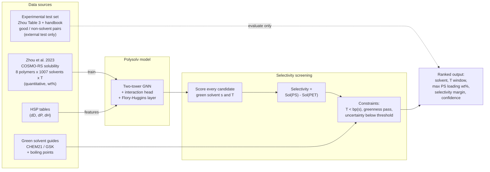
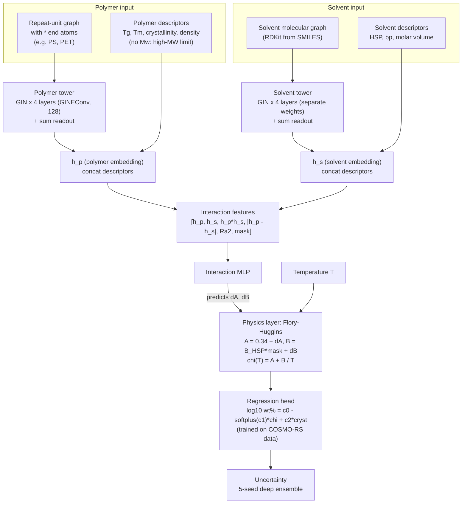
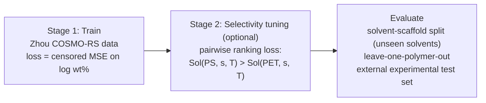

# Polysolv — Model Architecture

Physics-informed two-tower GNN for **selective green-solvent recommendation** (PS / PET separation).
Trained on Zhou et al. COSMO-RS data only; experimental data is used for external testing only. (Kern et al. is not used: its labelled data is not public.)

---

## 1. End-to-end pipeline

---

## 2. Model internals

---

## 3. Training and evaluation

**Total loss:**
`L = λ1·censored MSE(log wt%) + λ2·RankLoss(selectivity, optional) + λ3·physics_reg`

`physics_reg` keeps χ(T) monotonic/smooth and penalises non-physical A, B values.

---

## 4. Component summary

| Block | Input | Output | Why |
|---|---|---|---|
| Polymer tower | Repeat-unit graph + Tg/Tm/crystallinity/density | `h_p` | Graph alone misses PET crystallinity |
| Solvent tower | Solvent graph + HSP/bp | `h_s` | ~1000 solvents justifies a GNN; generalises to unseen green solvents |
| Interaction head | `[h_p, h_s, h_p*h_s, \|h_p-h_s\|, Ra², mask]` | ΔA, ΔB | Captures polymer–solvent interactions (dot product is too weak) |
| Flory–Huggins layer | A, B, T | χ(T) → solubility | Interpretable, extrapolates in temperature |
| Regression head | χ, crystallinity | log10 wt% | Solubility falls monotonically with χ |
| Uncertainty | Ensemble | σ per prediction | Flags unreliable recommendations |
| Screening layer | Predictions + green guide + bp | Ranked solvent list | Turns solubility into a **selectivity** decision |

---

## 5. Baselines and ablations

- **Baselines:** HSP RED ranking · XGBoost on Morgan fingerprints · plain two-tower (no physics layer)
- **Ablations:** − physics layer · − polymer descriptors · − interaction features · +σ-profiles (opt.)
- **Generalization:** leave-one-polymer-out (8 polymers is too few to claim polymer generalization)
- **External test:** experimental data (Zhou Table 3, handbook good/non-solvent pairs), never trained on
- **Validation:** gravimetric dissolution test of top-3 predicted solvents on real PS + PET waste (if lab access)

---

## 6. Optional: dissolution time

Not learned (little data). Can be estimated post-hoc with a simple swelling/diffusion model using predicted χ and particle size.

---

## 7. As implemented (Phase 3–4)

| Module | What it does |
|---|---|
| `dataset.py` | `PairDataset` row = (polymer, solvent, T). `collate` batches only the **unique** graphs of a mini-batch and maps rows to them (`s_index`, `p_index`). Flags `censored` (`M`, ≥ 50 wt%) and `floored` (wt% < 1e-3). |
| `model/towers.py` | GIN tower: atom embedding → 4 × [GINEConv → BN → ReLU → dropout] with residual connections → sum pool; descriptor MLP on [pool, descriptors] → h (128). |
| `model/interaction.py` | `[h_p, h_s, h_p⊙h_s, \|h_p−h_s\|, Ra²/100, mask]` → MLP (256, 128) → (ΔA, ΔB/300 K). Last layer zero-initialised → an untrained model **is** the Hansen prior. |
| `model/flory_huggins.py` | A = 0.34 + ΔA, B = B_HSP·mask + ΔB, χ = A + B/T. |
| `model/heads.py` | raw = c0 − softplus(c1)·χ + c2·x_cryst (log10 wt%), y_pred = log10(10^raw + 1e-3) — the label's own floor. Init: c0, c2 fitted on the prior, slope = best of a grid. |
| `losses.py` | censored MSE on raw (one-sided for `M` and for floor rows), RankNet loss on PS−PET margins (stage 2), L2 on ΔA, ΔB/300. |
| `train.py` | AdamW 1e-3, batch 256, ReduceLROnPlateau, early stopping on val MSE (patience 30). Logs per epoch → `results/training_logs/`. |
| `inference.py` | Featurises any (polymer, SMILES, T): Zhou solvents reuse Zhou descriptors; new solvents get McGowan V_s and optional HSP/bp. |
| `ensemble.py` | 5 seeds, mean ± σ, σ-binned calibration. |
| `mass_balance.py`, `screen.py`, `dissolution.py` | Screening grid 25 °C → min(bp − 10, 120 °C), conservative PS_lower / PET_upper (± 1σ), mass balance, Fickian time estimate. |

**Learned χ is an effective χ.** Its ordering is physical (PS at RT: water 4.7 > methanol 2.8 > hexane 1.4 > toluene 0.5 > THF 0.06; B > 0, so solubility rises with T), but the head places 10 wt% at χ ≈ 0.1, not at the Flory–Huggins χ_c = 0.5. Absolute χ values should not be read against 0.5.
