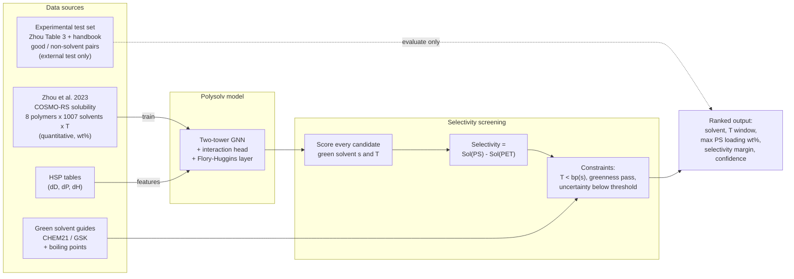
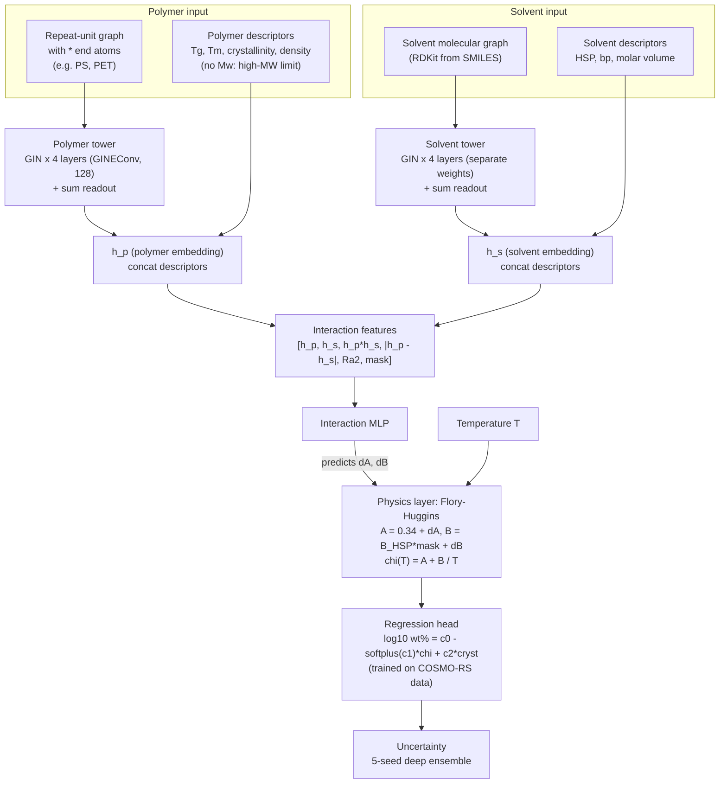
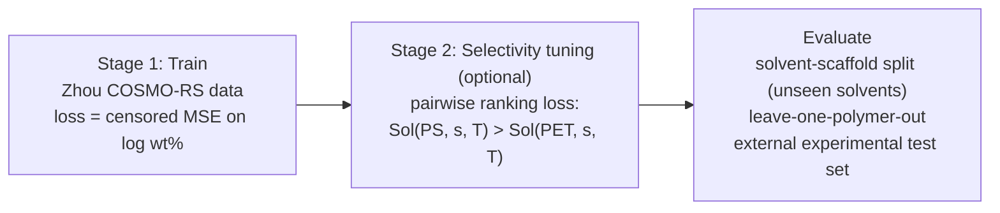

# Polysolv — Model Architecture

Physics-informed two-tower GNN for **selective green-solvent recommendation** (PS / PET separation).
Trained on Zhou et al. COSMO-RS data only; experimental data is used for external testing only. (Kern et al. is not used: its labelled data is not public.)

---

## 1. End-to-end pipeline

---

## 2. Model internals

---

## 3. Training and evaluation

**Total loss:**
`L = λ1·censored MSE(log wt%) + λ2·RankLoss(selectivity, optional) + λ3·physics_reg`

`physics_reg` keeps χ(T) monotonic/smooth and penalises non-physical A, B values.

---

## 4. Component summary

| Block | Input | Output | Why |
|---|---|---|---|
| Polymer tower | Repeat-unit graph + Tg/Tm/crystallinity/density | `h_p` | Graph alone misses PET crystallinity |
| Solvent tower | Solvent graph + HSP/bp | `h_s` | ~1000 solvents justifies a GNN; generalises to unseen green solvents |
| Interaction head | `[h_p, h_s, h_p*h_s, \|h_p-h_s\|, Ra², mask]` | ΔA, ΔB | Captures polymer–solvent interactions (dot product is too weak) |
| Flory–Huggins layer | A, B, T | χ(T) → solubility | Interpretable, extrapolates in temperature |
| Regression head | χ, crystallinity | log10 wt% | Solubility falls monotonically with χ |
| Uncertainty | Ensemble | σ per prediction | Flags unreliable recommendations |
| Screening layer | Predictions + green guide + bp | Ranked solvent list | Turns solubility into a **selectivity** decision |

---

## 5. Baselines and ablations

- **Baselines:** HSP RED ranking · XGBoost on Morgan fingerprints · plain two-tower (no physics layer)
- **Ablations:** − physics layer · − polymer descriptors · − interaction features · +σ-profiles (opt.)
- **Generalization:** leave-one-polymer-out (8 polymers is too few to claim polymer generalization)
- **External test:** experimental data (Zhou Table 3, handbook good/non-solvent pairs), never trained on
- **Validation:** gravimetric dissolution test of top-3 predicted solvents on real PS + PET waste (if lab access)

---

## 6. Optional: dissolution time

Not learned (little data). Can be estimated post-hoc with a simple swelling/diffusion model using predicted χ and particle size.
